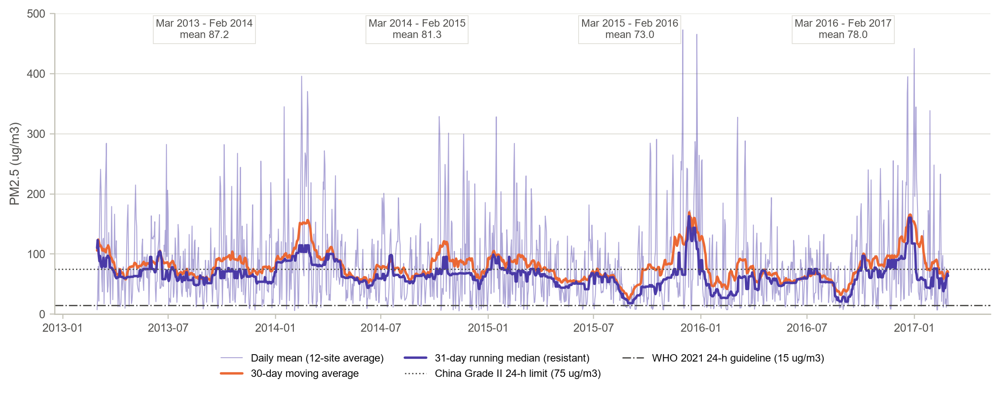
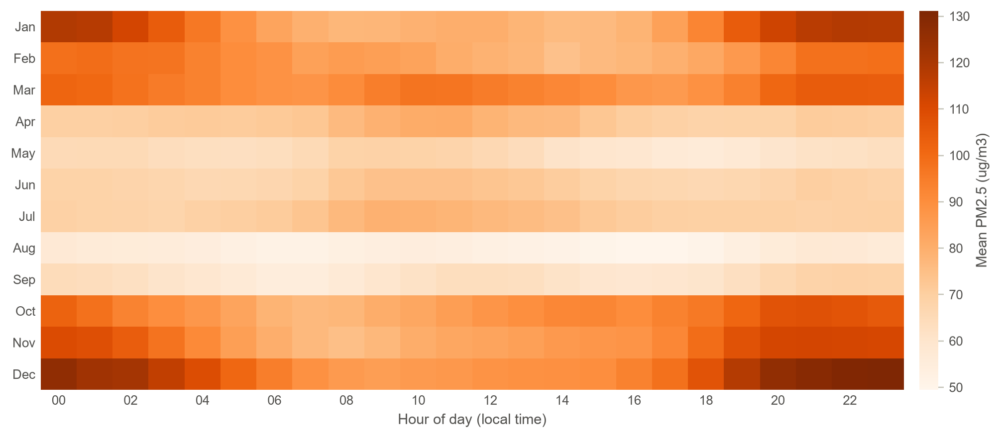
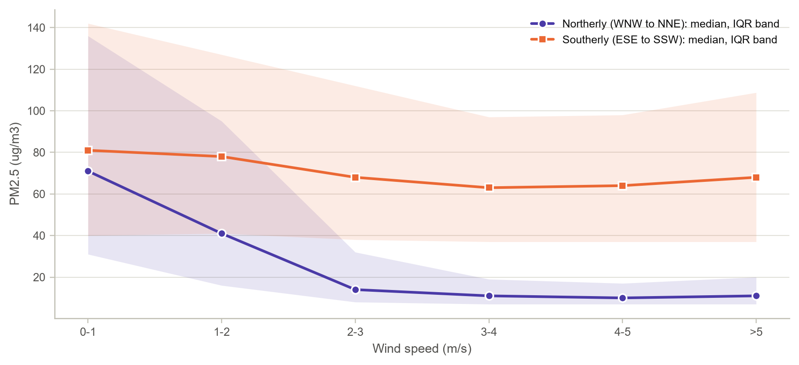
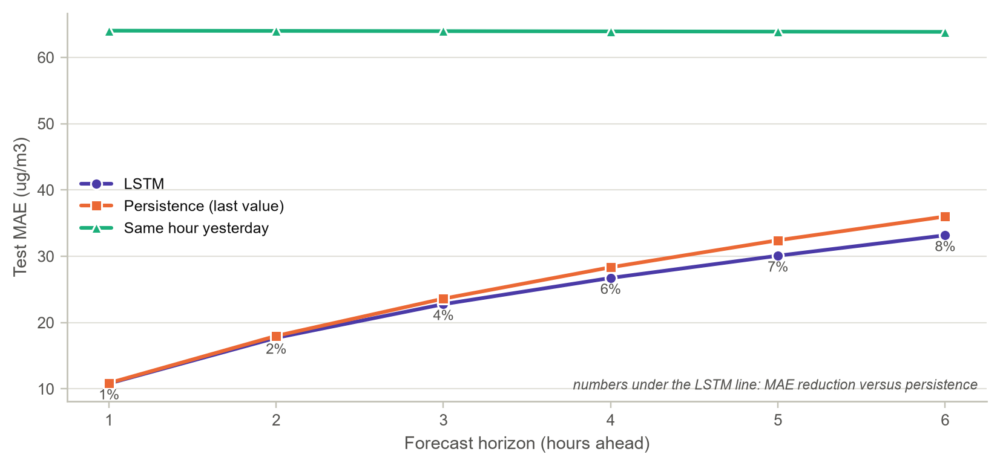

# Breathing Beijing

### Exploratory analysis and LSTM forecasting of PM2.5 from Beijing's multi-site air-quality records (2013-2017)

**Naveena B (24AD070)**, III Year B.Tech. Artificial Intelligence and Data Science, KPR Institute of Engineering and Technology
Course: U21ADP05 Exploratory Data Analysis and Visualization, Assignment II (case study)

---

## What this project does

1. **Explores** 420,768 hourly observations (six pollutants and five weather variables) from 12 monitoring sites in
   Beijing, from March 2013 to February 2017. It covers missing-data patterns, a sensor-spike filter, smoothing,
   decomposition, diurnal and seasonal cycles, distribution fitting, site comparison and wind effects.
2. **Forecasts** PM2.5 at the Dongsi site 1 to 6 hours ahead with a residual LSTM written in PyTorch, and compares it with
   persistence and same-hour-yesterday baselines.
3. **Lets you explore** the data in an offline interactive dashboard (`dashboard/index.html`).

The workflow follows Fry's seven stages of visualization: acquire, parse, filter, mine, represent, refine, interact.

## Data

* **Beijing Multi-Site Air Quality** (S. Chen), UCI Machine Learning Repository, dataset 501,
  [doi:10.24432/C5RK5G](https://doi.org/10.24432/C5RK5G), licence CC BY 4.0.
* The original archive is stored unchanged in `data/PRSA2017_Data_20130301-20170228.zip`; the code reads the 12 station
  CSV files directly from the zip.

## Layout

```
beijing-pm25-eda-lstm/   (https://github.com/Naveena0702/beijing-pm25-eda-lstm)
|-- data/                     original UCI zip archive
|-- notebooks/                beijing_pm25_analysis.ipynb (executed) + .py twin
|-- src/airq/                 config, data, stats_tools, model, viz, viz_results
|-- src/dashboard_template.html
|-- dashboard/index.html      interactive explorer (no internet needed)
|-- figures/                  28 report figures (g01 ... g28)
|-- results/                  results.json, CSV tables, lstm_best.pt
`-- report/                   case-study report, PDF and DOCX
```

## Reproduce

```bash
pip install -r requirements.txt
jupyter nbconvert --to notebook --execute --inplace notebooks/beijing_pm25_analysis.ipynb
```

The run takes about 9 minutes on a CPU. Seeds are fixed (2024) and PyTorch deterministic
algorithms are enabled.

## Highlights from the exploratory analysis

* Gaps are short (87% of PM2.5 gaps last 3 hours or less), so gaps of up to 24 hours were interpolated; a narrow
  Hampel-type filter removed only 290 single-hour sensor spikes, and fireworks nights were exempt.
* The annual mean fell from 87.2 to 73.0 ug/m3 and then
  rose to 78.0 in 2016-17. The daily city mean exceeded China's 75 ug/m3 limit on
  40% of days.
* Hourly PM2.5 fits gamma and Weibull laws with shape close to 1 better than the lognormal.
* Daily exceedance hours are U-shaped: a beta-binomial (alpha = 0.24, beta = 0.37) replaces the binomial,
  and episodes of 72 hours or more are 7 times more common than a memoryless model predicts.
* Strong northerly winds cut median PM2.5 from 71 to about
  10 ug/m3, while southerly winds barely help.

## Forecasting results (test period: Aug 2016 to Feb 2017, 8,444 windows)

Selected model: look-back 48 h, 64 hidden units, two LSTM layers with a skip connection from the latest
observation (residual learning), Huber loss, 57,318 parameters.

| Horizon | LSTM MAE | Persistence MAE | Gain | LSTM R2 |
|---|---|---|---|---|
| t + 1 h | 10.8 | 10.9 | +1% | 0.950 |
| t + 2 h | 17.7 | 18.0 | +2% | 0.873 |
| t + 3 h | 22.8 | 23.6 | +4% | 0.802 |
| t + 4 h | 26.7 | 28.3 | +6% | 0.738 |
| t + 5 h | 30.1 | 32.4 | +7% | 0.679 |
| t + 6 h | 33.2 | 36.0 | +8% | 0.621 |

As a 75 ug/m3 exceedance alert the forecast reaches AUC 0.986 one hour ahead and 0.889
six hours ahead (persistence: 0.880).

| | |
|---|---|
|  |  |
|  |  |

## Report

See [`report/`](report/) for the complete case-study report (PDF and Word).

## Software

Tested with Python 3.13, NumPy 2.5, pandas 3.0, SciPy 1.18, scikit-learn 1.9, Matplotlib 3.11 and PyTorch 2.13 (CPU).
